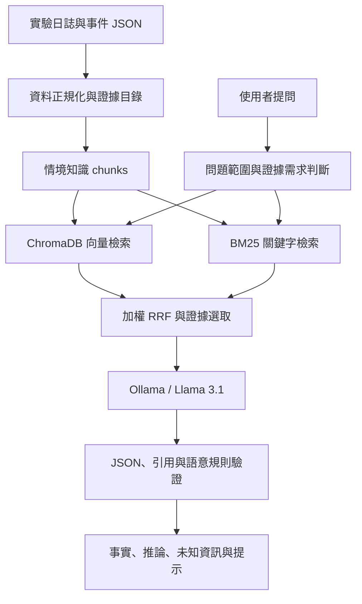

# OT Security Tutor

本地 LLM 驅動的 OT 資安事件證據檢索與教學系統。

將安全實驗的日誌與事件資料整理成可檢索的證據，結合混合檢索與本機語言模型，產生附來源引用的繁體中文回答，協助學習者重建事件並辨識證據缺口。

## 專案背景

這是我在實習期間獨立完成的概念驗證。主管提供初始 OT 資安情境資料，我在開發期間與主管討論需求和方向，並獨立完成情境資料整理、RAG 檢索與回答流程、介面、測試及評估。公開版本保留程式碼、整理後的情境資料與驗收摘要；原始交接資料與本機執行環境由原專案備份保存。

## 功能與技術

- **三情境隔離**：Ryuk-like、Industroyer2-like、FrostyGoop 報告衍生安全重建，各自使用知識包與 ChromaDB collection。
- **混合檢索**：EmbeddingGemma 向量檢索、BM25 + jieba 關鍵字檢索，再以加權 RRF 合併排名。
- **證據約束**：檢查 JSON 結構及引用 ID，回答區分已知事實、合理推論與未知資訊。
- **本機推論**：Ollama 執行 Llama 3.1 8B；支援 CLI、Tkinter 與 Open WebUI adapter。
- **評估流程**：固定 Ground Truth、robustness 題組、自動測試與人工 A/B 檢查。

本專案是單人使用的教學概念驗證。情境資料來自安全模擬或報告衍生重建，不應當作真實惡意程式執行紀錄。

## 系統架構



Ground Truth 僅用於評估，未整份加入學生檢索索引或模型提示。

## 回答展示

問題：**為什麼 Kali 不是直接修改 DC01 Share 的主機？**

既有 A/B 紀錄中的 RAG 回答指出：Kali 的 HTTP 紀錄支持其內容提供者角色，USER01 的端點紀錄支持其執行者角色；兩種證據需要分別解讀。引用包含 `RYUK-C01`、`RYUK-U01`。

此處為歷史回答摘要。完整比較見 [六題 A/B 展示](LLM檢索系統/AB_Comparison_Results.md)；展示步驟見 [Demo Runbook](LLM檢索系統/Demo_Runbook.md)。

## 歷史評估結果

以下取自 [2026-08-28 驗收報告](reports/final_validation.md)，不是在目前電腦重新執行的結果。

| 項目 | Ryuk | Industroyer2 | FrostyGoop |
| --- | ---: | ---: | ---: |
| Ground Truth 檢索評估 | 11/11 | 9/9 | 6/6 |
| Robustness 檢索評估 | 50/50 | 30/30 | 30/30 |

- 歷史自動測試：308 項通過。
- 六題 A/B 單次展示中，RAG 回答的引用均在當次檢索內容內（6/6）。
- 檢索通過率與引用合法性不等於回答正確率。A/B 的 B 組同時加入檢索、生成處理與驗證，不能將差異全部歸因於檢索。

## 快速開始（Windows PowerShell）

先安裝 Python 3.11 與 [Ollama for Windows](https://ollama.com/download/windows)，並進入下載後的專案根目錄。EmbeddingGemma 需使用支援該模型的 Ollama 版本（v0.11.10 或更新）。虛擬環境需在本機建立，不能直接沿用另一台電腦的 `.venv`。

```powershell
py -3.11 -m venv .venv
.\.venv\Scripts\python.exe -m pip install -r requirements.txt
if (-not (Test-Path .env)) { Copy-Item .env.example .env }
.\.venv\Scripts\python.exe -m pytest
```

啟動 Ollama，下載設定中的模型，再建立三情境索引：

固定模型版本可在 Ollama 模型庫確認：[Llama 3.1 8B Instruct Q5_0](https://ollama.com/library/llama3.1:8b-instruct-q5_0) 與 [EmbeddingGemma Q8_0](https://ollama.com/library/embeddinggemma:300m-qat-q8_0)。

```powershell
ollama pull llama3.1:8b-instruct-q5_0
ollama pull embeddinggemma:300m-qat-q8_0
.\.venv\Scripts\python.exe -m app.cli index --scenario ryuk --rebuild
.\.venv\Scripts\python.exe -m app.cli index --scenario industroyer2 --rebuild
.\.venv\Scripts\python.exe -m app.cli index --scenario frostygoop --rebuild
.\.venv\Scripts\python.exe -m app.ui
```

也可以透過 CLI 提問：

```powershell
.\.venv\Scripts\python.exe -m app.cli ask --scenario ryuk --mode explain "為什麼 Kali 不是直接修改 DC01 Share 的主機？"
```

自動測試使用模擬模型回應，不需執行 Ollama。實際檢索需要 embedding 模型與已建立的索引；生成回答另需要 chat 模型。模型下載大小與推論時間取決於硬體及網路。

Open WebUI 為選用介面，詳見 [操作手冊](docs/RAG_RUNBOOK.md)。

## 專案結構

| 目錄 | 內容 |
| --- | --- |
| `app/` | 檢索、生成、驗證、CLI 與介面 |
| `scenarios/` | 情境知識、證據目錄、評估題組與輸入資料 |
| `tests/` | 自動測試 |
| `scripts/` | 正規化、展示與評估工具 |
| `student_materials/` | 情境背景與學習材料 |
| `reports/` | 歷史驗收及人工檢查摘要 |
| `docs/` | 詳細操作與測試文件 |

原始來源文件、Ryuk 原始日誌、VM 腳本備份、本機環境、向量索引及逐題 JSON 執行紀錄不納入 Git 追蹤。公開版本提供 [Ryuk 證據摘要](scenarios/ryuk/public_evidence_summary.md) 和正規化事件資料；部分進階資料匯入或原始紀錄核對需要本機保留的來源檔案。

Ryuk 的 Lab 配置引用已指向公開的學習資料 `student_materials/ryuk/lab_architecture.md`。情境資料中原開發電腦的個人目錄改用 `lab-user` 代稱；IP、主機角色與證據 ID 保留供情境重現。

## 限制

- 證據 ID 是回答層級的引用清單，尚未逐句驗證每項主張。
- 語意驗證使用有限規則，仍需人工檢查回答。
- 資料量有限，固定題組的結果不能推廣為一般 OT 事件分析能力。
- 尚未實作自動漸進提示、自由作答評分與多人服務。
- 模型 context 預設為 4096；VM 資料仍由人工同步。
- 歷史 Ryuk 人工批次審查記錄了語意與教學品質問題；請參閱[審查摘要](reports/ryuk-manual-live-100-review.md)，不要僅以檢索評估或格式驗證判定回答品質。

## 延伸閱讀

- [詳細設計與原交接版說明](PROJECT_DETAILS.md)
- [操作手冊](docs/RAG_RUNBOOK.md)
- [專案導覽](專案導覽.md)
- [交接文件](HANDOFF.md)
